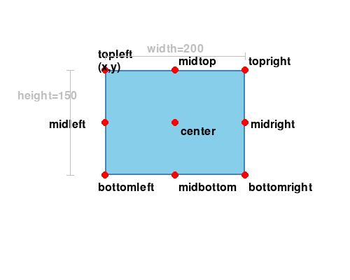

```text
図形・文字を描く方法と、グラフィックを動かす方法を学びましょう
以下のサンプルファイルを見ながら実際に動かしてみよう
```

# 目次
- [図形や文字を描く](#図形や文字を描く)
  - [画面の座標系](#画面の座標系)
  - [色の指定方法](#色の指定方法)
  - [図形を描く](#図形を描く)
    - [ドキュメントで調べて、図形を増やしてみよう](#ドキュメントで調べて図形を増やしてみよう)
  - [文字列を描く](#文字列を描く)
    - [ステップ1.フォントを用意する](#ステップ1フォントを用意する)
    - [ステップ2.そのフォントを使って、文字列の画像を作る](#ステップ2そのフォントを使って文字列の画像を作る)
    - [ステップ3.文字列の画像を画面に描画する](#ステップ3文字列の画像を画面に描画する)
- [グラフィックを動かす](#グラフィックを動かす)
  - [位置と大きさを表す変数：Rect](#位置と大きさを表す変数rect)
    - [基準点](#基準点)
  - [位置を繰り返し変え続ける](#位置を繰り返し変え続ける)
    - [ステップ1.ゲームの準備をする](#ステップ1ゲームの準備をする)
    - [ステップ5.絵を描いたり、判定したりする](#ステップ5絵を描いたり判定したりする)
    - [ステップ6.オブジェクトを表示する](#ステップ6オブジェクトを表示する)
- [演習問題1](#演習問題1)
  - [四角を斜めに移動させて、その後拡大させる](#四角を斜めに移動させてその後拡大させる)

---

# 図形や文字を描く

## 画面の座標系
pygameの画面の座標は、左上が原点(0,0)になり、
右に進むほどx軸の値が増え、下に進むほどy軸の値が増える

## 色の指定方法

詳細: [color_code.md](color_code.md)

pygameで色を指定する方法は主に3種類ある。

```python
pg.Color("RED")            # 色名（文字列）
pg.Color(255, 0, 0)        # RGB値
pg.Color(255, 0, 0, 128)   # RGBA値（透明度あり）
```

コードの中では `pg.Color("RED")` のように色名を使うのが一番わかりやすい。
よく使う色と RGB 値の対応は [color_code.md](color_code.md) を参照。

## 図形を描く
```python
# 四角形を描く
pg.draw.rect(screen, 色, (x, y, 幅, 高さ))
# pygameでは(x, y, 幅, 高さ)をRectというデータで扱う

# 線を引く
pg.draw.line(screen, 色, (x1,y1), (x2,y2), 太さ)
# 開始位置(x1,y1),終了位置 (x2,y2)

# 円を描く
pg.draw.ellipse(screen, 色, (x, y, 幅, 高さ), 太さ)
# 円をギリギリ囲む四角形の大きさで指定する
```

- 幅と高さが同じなら円、違えば楕円になる
- 四角形と円は、太さを省略する（または `0` にする）と塗りつぶし、数字を指定すると枠線になる
- 後から描いた図形は、先に描いた図形の上に重なる

サンプル: [01_draw_shapes/ex01.py](01_draw_shapes/ex01.py)

練習: [01_draw_shapes/practice01.py](01_draw_shapes/practice01.py)（「# ★」の部分が空欄になっているので、サンプルを見ながら自分の手でコードを打ち込んで完成させよう）

動いたら、数字を書き換えてもう一度動かし、変化を確認する。

| 変えるもの | 確認すること |
| --- | --- |
| 四角の `(100, 100, 100, 150)` → `(300, 200, 100, 150)` / `(100, 100, 200, 50)` | 前の2つは左上の位置、後ろの2つは幅と高さ。位置が動く・大きさが変わる |
| 線の太さ `5` → `1` / `20` | 数が大きいほど太い線になる |
| 円の `(400, 100, 150, 150)` → `(400, 100, 200, 100)` | 円をギリギリ囲む四角形が横長になるので、楕円になる |
| 円の太さ `5` → `0` / `20` | `0` は塗りつぶし。数を大きくすると枠が太くなる |
| 四角の最後に太さ（例: `5`）を足す | 塗りつぶしではなく枠線になる |
| `pg.Color("RED")` → `pg.Color(0, 255, 0)` / `pg.Color("YELLOW")` | 指定した色になる（色の指定方法は上の「色の指定方法」を参照） |
| 円を四角と重なる位置にずらし、2行の順番を入れ替える | 後から描いた方が上に重なる。順番を入れ替えると重なり方が逆になる |

### ドキュメントで調べて、図形を増やしてみよう
`pg.draw` には、`rect`・`line`・`ellipse` のほかにも図形を描く関数がある。
pygame のドキュメント（日本語訳）[https://westplain.sakura.ne.jp/translate/pygame/](https://westplain.sakura.ne.jp/translate/pygame/) で使い方を調べて、練習1（[01_draw_shapes/practice01.py](01_draw_shapes/practice01.py)）の「# ★ 自分で調べて図形を追加する」の下に、自分で図形を追加してみよう。

調べ方の流れ

1. ページ上部のメニューの「Draw」から `pygame.draw` のページを開き、関数の一覧から描いてみたい関数を選ぶ（例: `circle`・`polygon`・`arc`・`lines`）
2. その関数の書き方（`circle(surface, color, center, radius, width=0)` のような行）を見て、引数の意味と順番を確認する
   - 最初の2つは、どの関数も `surface`（描く先。ここでは `screen`）と `color`（色）
   - `width=0` のように `=` がついている引数は省略できる。省略すると、`=` の右の値になる
3. ループの中に1行足して動かし、思った通りに描けたか確認する
4. 引数の数字を変えて、どう変わるか確認する

> このドキュメントは日本語に翻訳されたもので、まだ翻訳されていない部分もある。

調べるポイント

| 関数 | 調べること |
| --- | --- |
| `circle` | 位置を指定する `center` は、四角形のときの `(x, y)` と同じ「左上」? |
| `polygon` | `points` には何を渡す? 点の数を3つ、4つにすると? |
| `arc` | 角度の単位は? どの位置から、どちら回りに描く? |
| `lines` | `closed` を `True` / `False` にするとどう変わる? |

<details>
<summary>答えと例</summary>

| 関数 | 答え |
| --- | --- |
| `circle` | `center` は円の**中心**の位置（左上ではない）。`radius` は半径 |
| `polygon` | `points` は頂点の座標 `(x, y)` のリスト。書いた順に点を結ぶ（3点なら三角形、4点なら四角形） |
| `arc` | 角度の単位は**ラジアン**（`math.pi` が180度）。`0` が右（3時の位置）で、左回り（反時計回り）に進む。太さを省略すると `1` の細い線になる |
| `lines` | `closed=True` なら最後の点と最初の点も線で結ぶ。`False` なら結ばない |

```python
import math   # arc で math.pi を使うために必要

# 円: 中心(600, 200)・半径50
pg.draw.circle(screen, pg.Color("PURPLE"), (600, 200), 50)

# 多角形: 3つの頂点を順に結んだ三角形
pg.draw.polygon(screen, pg.Color("ORANGE"), [(100, 400), (200, 300), (300, 400)])

# 円弧: 四角形(400, 300, 150, 150)に内接する円の、上半分（0度〜180度）
pg.draw.arc(screen, pg.Color("BLACK"), (400, 300, 150, 150), 0, math.pi, 5)

# 折れ線: 3つの点を結び、最後の点と最初の点も結ぶ
pg.draw.lines(screen, pg.Color("BLUE"), True, [(500, 450), (600, 400), (700, 450)], 3)
```

</details>

## 文字列を描く
pygameでは図形か画像しか表示できないため、画像にしてから表示する

### ステップ1.フォントを用意する
```python
"""font.Font関数で文字サイズを指定する
デフォルトのフォントを使う場合は、Noneと指定する"""
font = pg.font.Font(None, 文字サイズ)
```

### ステップ2.そのフォントを使って、文字列の画像を作る
```python
"""render関数で文字列から画像を作る
表示させたい文字列と文字の色を指定する
(Trueは文字列を滑らかにする指定)"""
画像変数 = font.render(文字列, True, 色)
```

デフォルトのフォント（`None`）では、日本語は表示できない（□になる）。日本語を表示するには、日本語に対応したフォントを指定する（→ [16_battle_game](../16_battle_game/README.md)）。

### ステップ3.文字列の画像を画面に描画する
```python
"""screenのblit関数を使って描画する
作った画像を入れた変数と、表示する位置(x,y)を指定する"""
screen.blit(画像変数, (x, y))
```

`(x, y)` は画像の**左上**の位置になる。`blit` は画像を描くときにも使う（→ [04_draw_images](../04_draw_images/README.md)）。

サンプル: [02_draw_text/ex02.py](02_draw_text/ex02.py)

練習: [02_draw_text/practice02.py](02_draw_text/practice02.py)

| 変えるもの | 確認すること |
| --- | --- |
| 文字サイズ `50` → `100` / `20` | 数が大きいほど大きな文字になる |
| `"hello!"` → `"good morning"` | 文字数が増えると、画像の横幅も広がる |
| `"hello!"` → `"こんにちは"` | □で表示される（デフォルトのフォントに日本語の字形が無いため） |
| `pg.Color("BLUE")` → `pg.Color("RED")` / `pg.Color(0, 128, 0)` | 指定した色の文字になる |
| 描画する位置 `(200, 100)` → `(400, 300)` / `(0, 0)` | 画像の左上がその位置に来る |
| `render` の `True` → `False` | `True` は輪郭がなめらか。`False` はギザギザになる（`100` などの大きいサイズで見比べる） |

---

# グラフィックを動かす

## 位置と大きさを表す変数：Rect
ゲームの中では、ただキャラクタを移動させるだけでなく、
「壁や敵と衝突したか」を調べる必要がある
そのために「x座標, y座標, 幅, 高さ」をひとまとめにしたデータをRectという

変数 = pg.Rect(x, y, 幅, 高さ)

Rectのそれぞれの値には、変数に".(ドット)"と「x,y,width,height」をつけてアクセスする

サンプル: [03_rect_object/ex03.py](03_rect_object/ex03.py)（ウィンドウは開かず、ターミナルに値を表示する）

練習: [03_rect_object/practice03.py](03_rect_object/practice03.py)

実行する前に、表示される値を予想してから確認するとよい。

| 変えるもの | 確認すること |
| --- | --- |
| `pg.Rect(10, 20, 30, 40)` の4つの数字 | 順番に x, y, 幅, 高さ になる |
| `data.x += 1` → `data.y += 5` | y だけが 5 増える（x は変わらない） |
| `data.x += 1` → `data.width *= 2` | 幅が 2 倍の `60` になる |
| `print` に `data.right` と `data.bottom` を足す | `right` は `x + 幅`（`40`）、`bottom` は `y + 高さ`（`60`）になる（次の「基準点」を参照） |
| `print` に `data.center` を足す | 中心の座標 `(25, 40)` になる（`data.x += 1` のあとは `(26, 40)`） |

### 基準点
Rectの`(x, y)`は**左上隅**が基準点になる


そのため、中心や右端・下端を基準にしたい場合は以下の属性を使う

| 属性 | 意味 |
| --- | --- |
| `rect.x` / `rect.y` | 左上のx,y座標 |
| `rect.topleft` | 左上 (x, y) |
| `rect.center` | 中心 (x, y) |
| `rect.centerx` / `rect.centery` | 中心のx / y座標 |
| `rect.right` | 右端のx座標 |
| `rect.bottom` | 下端のy座標 |

## 位置を繰り返し変え続ける
### ステップ1.ゲームの準備をする
```python
"""ゲームの準備の中で、図形をどこに表示させるかを変数myrectに用意する"""
myrect = pg.Rect(100,100,100,150)
```

### ステップ5.絵を描いたり、判定したりする
```python
"""ループの中でmyrectのxに1を足して、表示させる位置を少し右に移動させる
draw.rect関数で、表示させる位置と幅と高さをmyrectで指定する"""
myrect.x += 1
pg.draw.rect(screen, pg.Color("RED"), myrect)
```

### ステップ6.オブジェクトを表示する
```python
"""「pg.display.update()」で表示させるときに
「clock.tick(1秒間に処理する回数)」でスピードを調整する"""
pg.display.update()
clock.tick(FPS)
```

サンプル: [03_rect_object/ex04.py](03_rect_object/ex04.py)

練習: [03_rect_object/practice04.py](03_rect_object/practice04.py)

| 変えるもの | 確認すること |
| --- | --- |
| `myrect.x += 1` の `1` → `5` / `-1` | 数が大きいほど速く動く。マイナスにすると逆向き（左）に動く |
| `myrect.y += 1` を追加 | `x` と `y` が両方変わるので、右下へ斜めに動く |
| `pg.Rect(100, 100, 100, 150)` の幅・高さ | 四角の大きさが変わる |
| `pg.Rect(100, 100, ...)` の位置 → `(0, 400)` | 動き始める位置が変わる |
| `FPS = 60` → `10` | 1秒あたりの描画回数が減り、動きがカクカクして見える |
| 画面の右端（`800`）まで動き続ける | 画面の外に出て見えなくなる（`x` は増え続ける） |

---

# 演習問題1

## 四角を斜めに移動させて、その後拡大させる

> 問題: [question/question1.py](question/question1.py) / 解答: [question/answer/answer1.py](question/answer/answer1.py)
